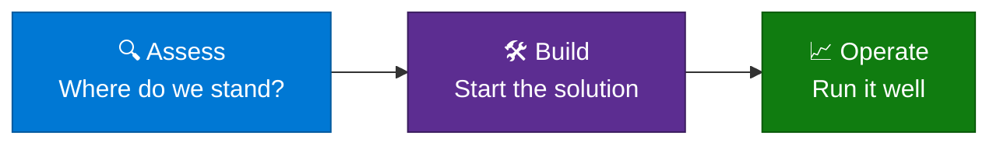

# 🧭 App Consult / FDE Resource Catalog

**The tools and accelerators from App Consult / Forward Deployed Engineering, one page each, all laid out the same way.**

[Browse](#-how-to-browse) · [Find the right resource](#-find-the-right-resource) · [All resources](#-all-resources) · [Contribute](#-contribute)

> [!IMPORTANT]
> **This catalog is not a support commitment.** Nothing here is an official Microsoft product, service or offer, and Microsoft doesn't support, warrant or guarantee any listed resource. Resources are provided as is, under the terms in each resource's own repository. Please review and test a resource yourself before you use it, and don't run it in production until you have. How you use it is your call and your responsibility.

## 🚀 About the program

App Consult / FDE pairs Microsoft engineers with customer teams to assess, build and operate solutions on Azure. Along the way, the engineers share the reusable tools they've built: FinOps tooling, AI accelerators and Azure tagging tools.

Each resource lives in its own repository. This one is just the catalog, with no code of its own. It describes every resource the same way and links to where it lives, so you can see what's out there and pick what fits.

## 🗂️ How to browse

Resources are grouped by what you're trying to do:

| | Category | You want to | Examples |
|---|---|---|---|
| 🔍 | [**Assess**](catalog/assess/README.md) | Understand where a workload stands today | FinOps |
| 🛠️ | [**Build**](catalog/build/README.md) | Start building a solution | AI accelerators |
| 📈 | [**Operate**](catalog/operate/README.md) | Run a solution that is already live | Tagging and cost governance |

Every entry follows the same outline: what it does, when to use it, prerequisites and limits. The quick facts (maturity, maintainer, link and last reviewed date) sit at the top of the page.

## 🎯 Find the right resource

| If your situation is... | Start with |
|---|---|
| "Our Azure bill is growing and we don't know why." | 🔍 Assess |
| "We're starting a new AI project on Azure and want a working base." | 🛠️ Build |
| "We want to see how hosted agents on Microsoft Foundry work." | 🛠️ Build |
| "Our tags are inconsistent and we want to tidy them before enforcing a policy." | 📈 Operate |

Not sure where you fit? Open an issue and tell us about your situation. We'll point you in the right direction.

## 📚 All resources

<!-- catalog-table:start -->
### 🔍 Assess

| Name | Maturity | Maintainer | Details |
|---|---|---|---|
| [FinOps Multitool TUI](https://github.com/z-larsen/FinOps-Multitool-TUI) | Prototype | Zac Larsen (@z-larsen) | [Details](catalog/assess/finops-multitool-tui.md) |

### 🛠️ Build

#### AI Accelerators

Starting points for AI solutions on Azure, including those built on Microsoft Foundry.

| Name | Maturity | Maintainer | Details |
|---|---|---|---|
| [Foundry Agent Accelerator](https://github.com/michael-rechani/foundry-agent-accelerator) | Prototype | Michael Rechani (@michael-rechani) | [Details](catalog/build/foundry-agent-accelerator.md) |

### 📈 Operate

| Name | Maturity | Maintainer | Details |
|---|---|---|---|
| [Azure Resource Tagger](https://github.com/z-larsen/AzureResourceTagger) | Field-tested | Zac Larsen (@z-larsen) | [Details](catalog/operate/azure-resource-tagger.md) |
<!-- catalog-table:end -->

## 🚫 What this catalog doesn't do

- It doesn't promise outcomes, service levels or support. Each resource is described as it is, and its own repository has the terms.
- It doesn't tell you a resource is safe or ready for production. That's a decision for you to make after your own review and testing.
- It doesn't hold code, scripts or customer data. Follow the links for those.

## 🤝 Contribute

Got a resource to add, an entry to update or an idea to suggest? See [CONTRIBUTING.md](CONTRIBUTING.md). The short version: copy [the template](templates/entry-template.md), fill it in, add yourself to [CODEOWNERS](.github/CODEOWNERS) and open a pull request. A GitHub Actions check makes sure the entry is complete, the links work and this table is up to date.

---

[Security](SECURITY.md) · [Code of conduct](CODE_OF_CONDUCT.md) · [License](LICENSE)

Resources are owned and licensed by their own repositories. Some are unofficial samples, not official Microsoft products. Each entry says so where it applies.

