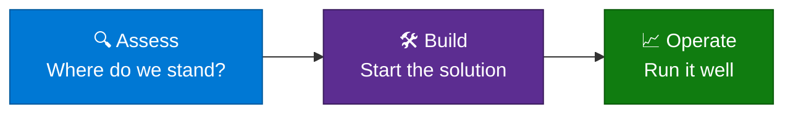

# 🧭 App Consult / FDE Resource Catalog

**Every App Consult / Forward Deployed Engineering resource, one page each, same layout.**

[Browse](#-how-to-browse) · [Find the right resource](#-find-the-right-resource) · [All resources](#-all-resources) · [Contribute](#-contribute)

> [!IMPORTANT]
> **This catalog is not a support commitment.** Nothing here is an official Microsoft product, service or offer, and Microsoft doesn't support, warrant or guarantee any listed resource. Resources are provided as is, under the terms in each resource's own repository. Review and test a resource yourself before you use it, and don't run one in a production environment until you've done so. You are responsible for how you use it.

## 🚀 About the program

App Consult / FDE pairs Microsoft engineers with customer teams to assess, build and operate solutions on Azure. Alongside that hands-on work, the program maintains a set of reusable resources: FinOps tooling, AI accelerators, and monitoring and cost governance guidance.

Each resource lives in its own repository. This repository is a catalog. It has no code of its own. It describes each resource in the same way and links to where it lives, so you can see what is available and pick what fits.

## 🗂️ How to browse

Resources are grouped by what you are trying to do:

| | Category | You want to | Examples |
|---|---|---|---|
| 🔍 | [**Assess**](catalog/assess/README.md) | Understand where a workload stands today | FinOps |
| 🛠️ | [**Build**](catalog/build/README.md) | Start building a solution | AI accelerators |
| 📈 | [**Operate**](catalog/operate/README.md) | Run a solution that is already live | Monitoring, cost governance |

Every entry uses the same headings: what it does, when to use it, prerequisites and limits. Its details (maturity, maintainer, link, last reviewed date) are at the top of the page.

## 🎯 Find the right resource

| If your situation is... | Start with |
|---|---|
| "We have a workload running and want to know how healthy it is." | 🔍 Assess |
| "We want to check a workload against a well-architected style review." | 🔍 Assess |
| "Our Azure bill is growing and we don't know why." | 🔍 Assess (FinOps) |
| "We're starting a new AI project on Azure and want a working base." | 🛠️ Build |
| "We need dashboards and alerts for a live solution." | 📈 Operate |
| "We need budgets, tagging or other cost controls on an ongoing basis." | 📈 Operate |
| "Our tags are inconsistent and we want to tidy them before enforcing a policy." | 📈 Operate |

Not sure where you fit? Open an issue and describe your situation.

## 📚 All resources

<!-- catalog-table:start -->
### 🔍 Assess

| Name | Maturity | Maintainer | Link |
|---|---|---|---|
| [FinOps Multitool TUI](catalog/assess/finops-multitool-tui.md) | Prototype | Zac Larsen (@z-larsen) | [Repository](https://github.com/z-larsen/FinOps-Multitool-TUI) |

### 🛠️ Build

#### AI Accelerators

Starting points for AI solutions on Azure, including those built on Microsoft Foundry.

| Name | Maturity | Maintainer | Link |
|---|---|---|---|
| [Foundry Agent Accelerator](catalog/build/foundry-agent-accelerator.md) | Prototype | Michael Rechani (@michael-rechani) | [Repository](https://github.com/michael-rechani/foundry-agent-accelerator) |

### 📈 Operate

| Name | Maturity | Maintainer | Link |
|---|---|---|---|
| [Azure Resource Tagger](catalog/operate/azure-resource-tagger.md) | Field-tested | Zac Larsen (@z-larsen) | [Repository](https://github.com/z-larsen/AzureResourceTagger) |
<!-- catalog-table:end -->

Details for maturity, maintainer and link are added as each entry is confirmed.

## 🚫 What this catalog doesn't do

- It doesn't promise outcomes, service levels or support. Each resource is described as it is. Check the resource repository for its own terms.
- It doesn't say a resource is safe or ready to run in production. That's your decision, after your own review and testing.
- It doesn't hold code, scripts or customer data. Follow the links for those.

## 🤝 Contribute

To add a resource, update an entry or suggest something new, see [CONTRIBUTING.md](CONTRIBUTING.md). The short version: copy [the template](templates/entry-template.md), fill it in, add yourself to [CODEOWNERS](.github/CODEOWNERS) and open a pull request. A GitHub Actions check confirms the entry is complete, the links work and this table is up to date.

---

[Security](SECURITY.md) · [Code of conduct](CODE_OF_CONDUCT.md) · [License](LICENSE)

Resources are owned and licensed by their own repositories. Some are unofficial samples, not official Microsoft products. Each entry says so where it applies.

